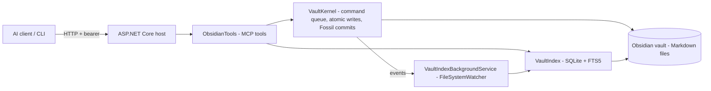

# aimcp

A self-hosted **Model Context Protocol (MCP) server and CLI** for your [Obsidian](https://obsidian.md) vault, written in C# / ASP.NET Core.

It exposes your vault to remote AI clients (Claude, ChatGPT, Grok, etc.) over Streamable HTTP with a **stateless** transport and bearer-token auth, and keeps a local **SQLite FTS5 index** for fast full-text search, backlinks, tags, and vault analytics. All changes are versioned with **Fossil**.

## Features

- **Stateless MCP server** (`/mcp`) — works with hosted AI clients that can't maintain sessions; every request is self-contained.
- **Bearer-token auth** — SHA-256 hashed, constant-time comparison; token never stored in plaintext.
- **FTS5 full-text search** plus tag search, backlinks (`links-to`), orphans, and stalled-note detection.
- **Schema enforcement** — frontmatter validated against note types (`idea`, `question`, `decision`, `project`, `person`, `digest`, `reference`) with required fields and status state machines (e.g. `idea`: `seed → exploring → testing → done`, branch to `abandoned` anytime).
- **Live indexing** — `FileSystemWatcher` keeps the SQLite index in sync with external edits (debounced, full rebuild on startup).
- **Fossil version control** — kernel writes are atomic and batch-committed to a Fossil repository.
- **Soft deletes** — `delete` moves notes to the vault's top-level `.trash/` folder; direct writes to `.trash` are blocked.
- **Path safety** — all operations resolve inside the vault root; anything outside is rejected.
- **Built-in CLI** — run the same operations from the terminal.

## Requirements

- .NET 8+ (ASP.NET Core)
- [Fossil](https://fossil-scm.org) on PATH (optional; needed for versioning)
- An Obsidian vault (folder of Markdown files)

## Configuration

Environment variables (preferred on VPS/Docker) or `appsettings.json`:


| Env var               | appsettings                     | Description                                                          |
| --------------------- | ------------------------------- | -------------------------------------------------------------------- |
| `OBSIDIAN_VAULT_PATH` | `VaultPath`                     | Absolute path to the Obsidian vault                                  |
| `MCP_BEARER_TOKEN`    | `Mcp:BearerToken`               | Bearer token protecting `/mcp` (**required**)                        |
| `AIMCP_INDEX_PATH`    | `IndexPath`                     | SQLite index location (default: `aimcp-index.db` next to the binary) |
| `AIMCP_FOSSIL_REPO`   | `Fossil:RepoPath`               | Fossil repository for the vault                                      |
| —                     | `Fossil:BatchDelayMilliseconds` | Fossil commit batch delay (default `1000`)                           |


The server refuses `/mcp` requests if no bearer token is configured and logs a warning if it contains `change-me`.

## Run as MCP server

```bash
export OBSIDIAN_VAULT_PATH=/path/to/vault
export MCP_BEARER_TOKEN="a-long-random-secret"

dotnet run
```

Endpoints:

- `POST /mcp` — MCP endpoint (Streamable HTTP, stateless, bearer auth; CORS open)
- `GET /health` — health check (`{"status":"ok","service":"aimcp","mode":"stateless"}`)
- `GET /.well-known/oauth-protected-resource` — advertises bearer auth for MCP clients

Point an MCP client at `https://your-host/mcp` with the bearer token as the authorization header.

## Run as CLI

Any subcommand switches to CLI mode (no web server):

```bash
aimcp write <path> <content>
aimcp append <path> <content>
aimcp move <source> <destination>
aimcp delete <path>
aimcp transition <path> <status>
aimcp search <query>
aimcp tags
aimcp links-to <path>
aimcp orphans
aimcp stalled [days]
aimcp history <path> [limit]
aimcp validate [path]
aimcp digest [days]
```

Query commands output JSON; mutating commands print a message and exit non-zero on failure.

## MCP tools


| Tool                                   | Description                                                 |
| -------------------------------------- | ----------------------------------------------------------- |
| `ListNotes(folder)`                    | List notes in a folder (empty = root)                       |
| `ReadNote(notePath)`                   | Read a note's full content                                  |
| `SearchNotes(query, maxResults)`       | FTS5 full-text search                                       |
| `WriteNote(notePath, content)`         | Create or overwrite a note                                  |
| `AppendToNote(notePath, content)`      | Append to (or create) a note                                |
| `CopyNote(source, dest)`               | Copy a note; fails if dest exists                           |
| `MoveNote(source, dest)`               | Move/rename; dest can be a folder                           |
| `DeleteNote(notePath)`                 | Soft-delete into `.trash/`                                  |
| `GetNoteProperties(notePath)`          | Read YAML frontmatter                                       |
| `SetNoteProperties(notePath, props)`   | Set/update frontmatter properties                           |
| `GetNoteTags` / `AddTag` / `RemoveTag` | Tag management per note                                     |
| `ListAllTags()` / `SearchByTag(tag)`   | Vault-wide tag listing/search                               |
| `TransitionNote(notePath, status)`     | Move a note through its type's state machine                |
| `QueryHistory(notePath, limit)`        | Change history for a note                                   |
| `LinksTo(notePath)`                    | Backlinks to a note                                         |
| `Orphans()`                            | Notes with no incoming/outgoing links                       |
| `Stalled(daysWithoutEdit)`             | Notes not modified in N days                                |
| `ValidateSchema(notePath)`             | Validate frontmatter against the schema (empty = all notes) |
| `Digest(days)`                         | Summary: recent activity, orphans, stalled notes            |


## Architecture



- **VaultKernel** — background service; serializes all mutations through a command channel, validates paths/content, writes atomically, emits `VaultEvent`s, batches Fossil commits.
- **VaultIndex** — SQLite index of notes, tags, links, and history (FTS5 full-text).
- **VaultIndexBackgroundService** — watches the vault for external edits and keeps the index current; kernel-originated changes are suppressed to avoid double-indexing.

## Security notes

- Only `.md` files inside the vault root are writable; path traversal is rejected.
- Writes are schema-validated before they touch disk.
- `/mcp` requires the bearer token on every request (OPTIONS preflight excluded).
- Recommended deployment: run behind a reverse proxy with TLS (e.g. Caddy/nginx).

## License

MIT License see LICENSE file for details.